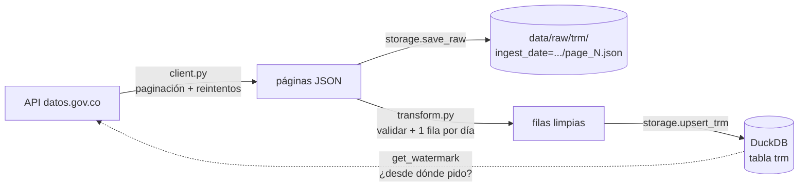

# Proyecto 3 · Ingesta incremental desde una API

Parte de mi [ruta de ingeniería de datos](https://github.com/josemelguizo/ruta-datos).

 

> **Esto es un reto, no una solución.** El orquestador (`pipeline.py`) y las pruebas están listos; el cliente de la API, la validación y la carga los escribes tú.

## El reto

El área financiera necesita la **TRM** (Tasa Representativa del Mercado, pesos por dólar) de cada día desde 1991, actualizada a diario. La fuente oficial es la API de [datos.gov.co](https://www.datos.gov.co/), dataset `32sa-8pi3`.

Las APIs reales fallan: se caen, te limitan la velocidad (error 429), devuelven datos raros. Tu pipeline tiene que aguantar todo eso, y además ser **incremental**: cada día pide solo lo nuevo, no todo el histórico.

## Qué vas a practicar

- Consumir una API REST con paginación
- Reintentos con *backoff* exponencial y respeto de `Retry-After`
- Capas de datos: crudo (*bronze*) en JSON y limpio en tabla
- Carga incremental con marca de agua (*watermark*) y *upsert*
- Validar datos sin detener la carga
- Pruebas con dobles (sesión falsa) e inyección de dependencias

## Arquitectura



## Preparación

```bash
python -m venv .venv
.venv\Scripts\activate          # Windows  (source .venv/bin/activate en macOS/Linux)
pip install -e ".[dev]"
copy .env.example .env          # opcional: agrega tu token de datos.gov.co
pytest                          # todo en rojo: ese es el punto de partida
```

Antes de programar, mira los datos en el navegador:
`https://www.datos.gov.co/resource/32sa-8pi3.json?$limit=5&$order=vigenciadesde DESC`

## Fases

| Fase | Archivo | Tests |
|---|---|---|
| 1. Paginación | `client.py` → `fetch_pages` | `pytest -k "pagina or filtro or generador or token"` |
| 2. Reintentos | `client.py` → `_get_with_retry` | `pytest -k "reintenta or retry or rinde or cliente"` |
| 3. Validación | `transform.py` | `pytest -k "dia or rechaza or ordenada"` |
| 4. Almacenamiento | `storage.py` → `get_watermark`, `upsert_trm` | `pytest -k "watermark or upsert"` |
| 5. Punta a punta | (nada nuevo) | `pytest -k "pipeline"` |

Las pruebas de la API usan `tests/fakes.py`: una sesión falsa que devuelve las respuestas que tú decidas, sin red. Léelo antes de empezar la fase 1.

Cuando todo esté en verde, córrelo contra la API real:

```bash
python -m ingesta.pipeline --full    # primera vez: todo el histórico
python -m ingesta.pipeline           # siguientes: solo lo nuevo
```

## Fase 6 · Explora lo que cargaste

En DuckDB (`duckdb trm.duckdb` o desde Python):

1. TRM máxima y mínima de la historia, con su fecha.
2. Promedio mensual de 2024 y 2025.
3. Los 5 días con la mayor variación frente al día anterior (pista: `LAG`).
4. ¿Hay algún día sin TRM entre 1991 y hoy? Debería no haber huecos.

## Criterios de terminado

- [ ] `pytest` en verde, también en GitHub Actions
- [ ] Carga completa real funcionando y la segunda corrida trae solo días nuevos
- [ ] Las 4 consultas de la fase 6 en `consultas.sql`
- [ ] README reescrito con tus decisiones y las respuestas a las preguntas de los docstrings

## Para ir más allá

- Programa la ingesta diaria con el Programador de tareas de Windows o `cron`. (En el proyecto 4 lo harás con Airflow.)
- Agrega un segundo dataset de datos.gov.co reutilizando el mismo `SocrataClient`. Si tuviste que cambiar el cliente, ¿qué tan genérico era?
- Registra cada ejecución (inicio, fin, filas, rechazados) en una tabla `ingest_runs`, como en el proyecto 1.

## Recursos

- [Socrata: consultas SoQL](https://dev.socrata.com/docs/queries/)
- [Ficha del dataset TRM en la API](https://dev.socrata.com/foundry/www.datos.gov.co/32sa-8pi3)
